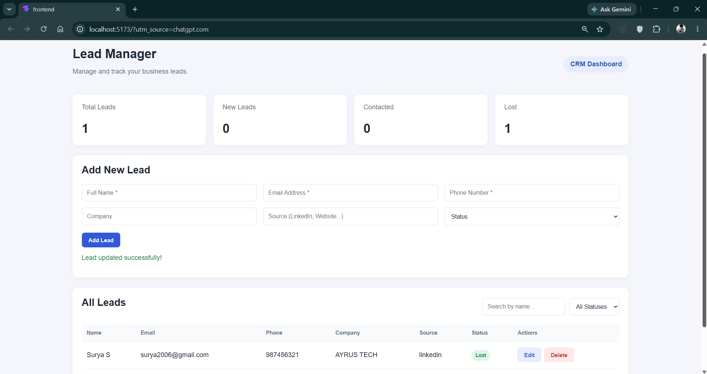

# Lead Manager

A full-stack Lead Management System developed as part of the **Meru Technosoft Pvt. Ltd. Full Stack Developer screening assignment**.

Lead Manager helps users manage business leads through a simple dashboard with lead creation, updating, searching, filtering and deletion.

## Features

- Add new leads with personal and company information
- View all leads in a structured table
- Edit existing lead details
- Update lead status
- Delete leads with confirmation
- Search leads by name
- Filter leads by status
- Frontend and backend validation
- Duplicate email prevention
- REST API integration
- Dashboard statistics
- Automated backend testing

## Technology Stack

### Frontend
- React.js
- Vite
- JavaScript
- CSS
- Axios
- React Router
- Lucide React

### Backend
- Python
- Flask
- Flask-CORS
- Flask-SQLAlchemy
- REST API

### Database
- SQLite

### Testing
- Pytest

## Project Structure

```text
Lead-Manager/
│
├── frontend/
│   ├── src/
│   │   ├── App.jsx
│   │   ├── App.css
│   │   ├── index.css
│   │   └── main.jsx
│   └── package.json
│
├── backend/
│   ├── app/
│   │   ├── __init__.py
│   │   ├── models.py
│   │   └── routes.py
│   │
│   ├── tests/
│   │   ├── conftest.py
│   │   └── test_leads.py
│   │
│   ├── config.py
│   ├── run.py
│   └── requirements.txt
│
├── screenshots/
│   └── dashboard.png
│
├── .gitignore
└── README.md
```

## Installation and Setup

### Prerequisites

- Python 3.10 or later
- Node.js and npm
- Git

### 1. Clone the Repository

```bash
git clone https://github.com/AYRUS1515/Lead-Manager.git

cd Lead-Manager
```

### 2. Backend Setup

Open a terminal and run:

```powershell
cd backend

python -m venv venv

.\venv\Scripts\Activate.ps1

pip install -r requirements.txt

python run.py
```

Backend URL:

http://127.0.0.1:5000

### 3. Frontend Setup

Open another terminal:

```bash
cd frontend

npm install

npm run dev
```

Frontend URL:

http://localhost:5173

Keep both frontend and backend servers running while using the application.

## API Endpoints

| Method | Endpoint | Description |
|---|---|---|
| GET | `/api/leads` | Retrieve all leads |
| POST | `/api/leads` | Create a new lead |
| PUT | `/api/leads/{id}` | Update an existing lead |
| DELETE | `/api/leads/{id}` | Delete a lead |

## Lead Information

Each lead contains:

- ID
- Name
- Email
- Phone
- Company
- Source
- Status

### Allowed Lead Statuses

- New
- Contacted
- Qualified
- Lost

## Running Automated Tests

From the backend directory:

```bash
python -m pytest -v
```

The backend test suite previously completed successfully with **8 passing tests**.

## Assumptions

- Each lead must have a name, email and phone number.
- Email addresses must be valid and unique.
- A lead can have one of four statuses: New, Contacted, Qualified or Lost.
- SQLite is used for local data persistence.
- Authentication is not included in the current implementation.

## Future Improvements

- User authentication and role-based access
- Pagination and sorting
- Advanced search and filtering
- Dashboard charts and analytics
- Cloud database integration
- Live deployment

## Application Preview



## What I'm Proud Of

I built this application by integrating a React frontend with a Python Flask backend and SQLite database. One of the challenging aspects was implementing CRUD operations, API validation and frontend-backend communication. This project helped me understand how different components of a full-stack application work together.

## Developer

Developed by **Surya S**

Full Stack Development | Computer Science and Engineering

GitHub: https://github.com/AYRUS1515
